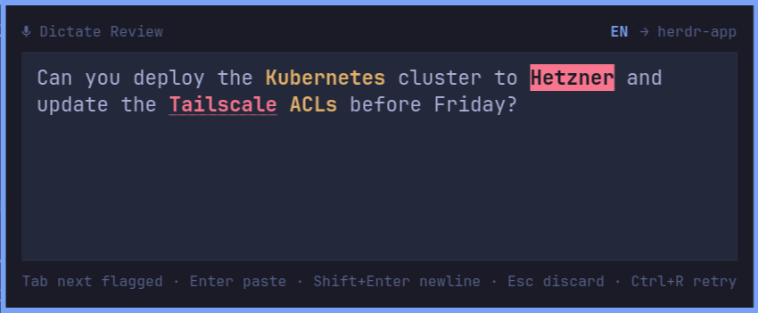
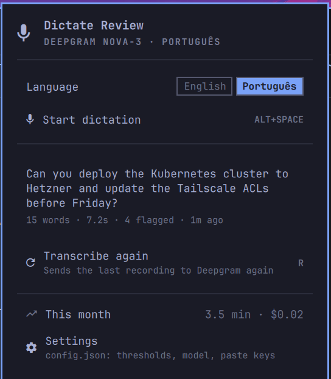

# Dictate Review

Voice dictation for [Omarchy](https://omarchy.org) that shows **how sure the transcription is about each word**, so you only fix the words that need it.



<span>🔴</span> confidence below 0.60 · <span>🟡</span> below 0.85 · the rest is plain. Hover a word to see its score.

## How it works

1. <kbd>Alt+Space</kbd> starts recording. A glow shows on the window you're in.
2. <kbd>Alt+Space</kbd> again. The audio goes to [Deepgram](https://deepgram.com) nova-3, which scores every word.
3. The popup opens with the doubtful words highlighted. <kbd>Tab</kbd> jumps between them; type to fix.
4. <kbd>Enter</kbd> pastes into the window where you started.

## Bar widget



Right-click the icon to switch English / Português · middle-click to dictate.

## Install

```bash
echo 'export DEEPGRAM_API_KEY=...' >> ~/.config/env/secrets.sh
./install.sh
```

Needs `python-gobject gtk4 gtk4-layer-shell wtype wl-clipboard pipewire`. Costs about $0.0043/min.

## Files

```
app/         dictate_review.py (commands)  glow.py (record + glow)  popup.py (review)
bin/         dictate-review, Omarchy dictation backend
hypr/        window rules
bar-plugin/  Omarchy bar widget (forked from Superwhisper's MIT panel)
```

Explicação completa (pt-BR, com animação e quiz): [docs/explicado.pt-BR.html](https://htmlpreview.github.io/?https://github.com/kevin-weitgenant/dictate-review/blob/main/docs/explicado.pt-BR.html)

MIT
